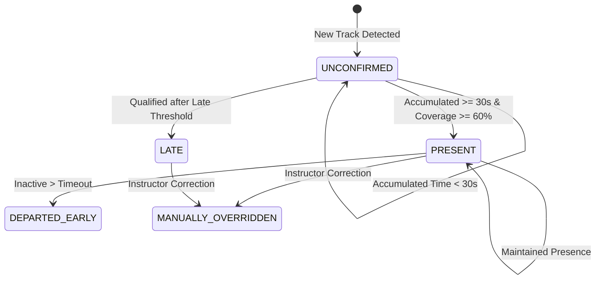

# Multimodal Attendance & Engagement Agent

[](#)
[](#)
[](#)
[](#)

A complete, functional, offline-first application designed for educational institutions and professional training environments. It combines real-time computer vision (face detection, multi-object tracking, 3D head-pose estimation, movement/inactivity measurement) and acoustic signal processing (RMS energy, zero-crossing rate, speech vs. silence voice activity detection) to deliver sustained-presence attendance tracking, multimodal engagement analytics, explainable AI teaching recommendations, and downloadable CSV/PDF reports.

---

## 1. Key Objectives & Highlights

1. **Automatic Detection & Tracking**: Face detection and session-scoped Multi-Object Tracking (MOT) using IoU and centroid affinity without assuming every detection is a separate attendee.
2. **Sustained-Presence Attendance State Machine**: Attendance is marked `PRESENT` only after accumulating sustained observation time (e.g. 30 seconds with 60% coverage). Transient disappearances (< 10s grace period) do not reset state.
3. **Late Arrival & Absence Management**: Differentiates on-time attendees, late arrivals (> configurable threshold), unconfirmed transient tracks, and departures.
4. **Observable Engagement Analysis**: Analyzes physical signals (head-pose yaw/pitch/roll, physical displacement, stillness) rather than claiming to read internal mental states.
5. **Classroom Acoustic Analysis**: Captures acoustic dynamics (vocal formants, speech duration vs silence, conversation exchanges) without identifying individual student voices.
6. **Multimodal Feature Fusion**: Dynamic weight renormalization (default 70% visual, 30% audio). If a modality is absent or silent, weights renormalize dynamically without generating false zeros.
7. **Explainable AI Teaching Suggestions**: Deterministic rule-based pedagogical engine analyzing chronological trends ($\Delta = \bar{S}_{\text{second\_half}} - \bar{S}_{\text{first\_half}}$), acoustic density, and visual orientation to generate actionable recommendations with supporting evidence and limitations notes. Pluggable local LLM (Ollama) supported.
8. **100% Offline-First & Privacy Preserving**: Zero external cloud APIs (no Gemini, OpenAI, or third-party cloud required). Ephemeral frame processing discards raw video/audio from RAM immediately after feature extraction.
9. **Compliance & Audit Logging**: Every manual attendance override, report generation, and student mapping generates an immutable audit log entry.
10. **Reports & Exports**: One-click printable PDF report generation (via ReportLab) and CSV exports with explicit formulas and disclaimers.

---

## 2. Technology Stack

- **Frontend**: HTML5, CSS3 (Modern Responsive UI, Custom CSS Variables, Accessible Contrast), Vanilla JavaScript, Chart.js, Socket.IO Client.
- **Backend**: Python 3.11+, Flask REST API (Application Factory & Modular Blueprints), Flask-SocketIO (Real-Time Local WebSockets), SQLAlchemy with SQLite.
- **Computer Vision**: OpenCV (video capture, frame resizing, solvePnP 3D Euler angle estimation, Haar Cascade / DNN / MediaPipe fallback).
- **Acoustic Signal Processing**: SoundDevice, NumPy, SciPy (RMS energy calculation, zero-crossing rate, voice activity detection).
- **Reporting**: ReportLab (Printable PDF documents with tables and headers), Python CSV standard library.
- **Testing**: Pytest with automated unit and integration tests.

---

## 3. Project Directory Structure

```text
multimodal-attendance-agent/
├── app/
│   ├── __init__.py               # Application factory & data seeder
│   ├── config.py                 # Configuration classes (Dev, Testing, Prod)
│   ├── extensions.py             # SQLAlchemy & SocketIO singletons
│   ├── views.py                  # HTML template views & MJPEG stream
│   ├── models/                   # SQLAlchemy database models
│   │   ├── __init__.py
│   │   ├── user.py               # Instructor accounts & password hashing
│   │   ├── student.py            # Enrolled students & consent status
│   │   ├── course.py             # Academic courses & batches
│   │   ├── session.py            # Classroom sessions & metadata
│   │   ├── attendance.py         # Timestamped attendance records & observations
│   │   ├── analytics.py          # Engagement windows, audio windows & fusion results
│   │   ├── suggestion.py         # AI pedagogical suggestions & evidence
│   │   ├── settings.py           # Privacy, retention & consent policies
│   │   └── audit.py              # Immutable compliance audit logs
│   ├── api/                      # Versioned REST API endpoints (/api/v1)
│   │   ├── __init__.py
│   │   ├── health.py             # System health & offline capabilities
│   │   ├── dashboard.py          # Summary metrics & recent activity
│   │   ├── students.py           # Student CRUD & CSV import
│   │   ├── sessions.py           # Session lifecycle (start, pause, stop, finalize)
│   │   ├── attendance.py         # Attendance logs & instructor overrides
│   │   ├── engagement.py         # Multimodal fusion timeline & decomposition
│   │   ├── suggestions.py        # Pedagogical recommendations & evidence
│   │   ├── reports.py            # CSV & printable PDF generation
│   │   └── settings.py           # Privacy policies & data purge
│   ├── auth/                     # Authentication blueprint
│   │   ├── __init__.py
│   │   └── routes.py             # Login, logout & session checks
│   ├── services/                 # Business logic & perceptual processing
│   │   ├── __init__.py
│   │   ├── tracking_service.py   # IoU & centroid multi-object tracker
│   │   ├── attendance_service.py # Sustained-presence state machine
│   │   ├── face_detection_service.py # Face detection (Multi-backend)
│   │   ├── head_pose_service.py  # 3D solvePnP & landmark Euler angles
│   │   ├── movement_service.py   # Micro-movements, inactivity & confidence
│   │   ├── audio_service.py      # RMS energy, ZCR & voice activity detection
│   │   ├── fusion_service.py     # Multimodal fusion & weight renormalization
│   │   ├── suggestion_service.py # Explainable pedagogical suggestion agent
│   │   ├── video_service.py      # Video ingestion, webcam & synthetic stream
│   │   ├── session_service.py    # Background thread runner & WebSocket broadcast
│   │   └── report_service.py     # ReportLab PDF & CSV generator
│   ├── templates/                # Responsive HTML5 templates
│   │   ├── base.html             # Sidebar navigation, topbar & alerts
│   │   ├── index.html            # Dashboard overview & quick metrics
│   │   ├── students.html         # Student directory, search & modals
│   │   ├── sessions.html         # Session catalogue & creation modal
│   │   ├── session_detail.html   # Session overview & action triggers
│   │   ├── live_monitor.html     # Live monitoring cockpit & canvas overlays
│   │   ├── attendance.html       # Timestamped attendance table & overrides
│   │   ├── engagement.html       # Chart.js engagement timeline & decomposition
│   │   ├── suggestions.html      # AI suggestions, evidence & limitations
│   │   ├── reports.html          # PDF & CSV download center
│   │   ├── settings.html         # Privacy controls, retention & audit log
│   │   └── login.html            # Instructor login form
│   ├── static/                   # Static frontend assets
│   │   ├── css/style.css         # Modern styling, responsive grid & modals
│   │   └── js/                   # Vanilla JavaScript controllers
│   │       ├── main.js           # Toast alerts & modal handlers
│   │       ├── dashboard.js      # Live dashboard polling & metrics
│   │       ├── live_monitor.js   # Canvas drawing & WebSocket listener
│   │       └── charts.js         # Chart.js visual/audio decomposition
│   └── utils/
│       ├── security.py           # Path sanitization, CSRF & audit logging
│       └── validators.py         # Input validation & schema checks
├── docs/
│   ├── architecture.md           # Mermaid system diagram & layer architecture
│   ├── privacy.md                # Data flow specifications & ethical safeguards
│   └── testing.md                # Test execution report & validation criteria
├── instance/                     # SQLite database directory (attendance_agent.db)
├── local_models/                 # Offline model weights & checkpoints
├── reports/                      # Generated PDF & CSV artifacts
├── uploads/                      # Safely sanitized uploaded video/audio files
├── tests/                        # Automated Pytest suite (27 unit/integration tests)
├── scripts/
│   └── seed_demo_data.py         # Populates demonstration classroom sessions
├── start_windows.bat             # One-click Windows startup
├── start_linux.sh                # Linux/macOS startup
├── requirements.txt              # Pinned Python dependencies
├── pytest.ini                    # Pytest configuration
├── .env.example                  # Environment configuration template
├── run.py                        # Application entry point
└── README.md
```

---

## 4. Installation & Local Execution

### Prerequisites
- Python 3.11+
- Virtual environment tool (`venv` or `conda`)
- A webcam and microphone (optional; the application includes a synthetic stream generator for hardware-free development and headless test execution)

### Windows Setup
```cmd
REM 1. Clone / Navigate to project
cd "c:\Users\Asus\Desktop\gen ai"

REM 2. Create virtual environment
python -m venv .venv
.venv\Scripts\activate

REM 3. Install dependencies
pip install -r requirements.txt

REM 4. Seed demo data (optional, creates sample course, students, session, and PDF)
python scripts\seed_demo_data.py

REM 5. Run application
python run.py
```
*Alternatively, double click `start_windows.bat`.*

### Linux / macOS Setup
```bash
python3 -m venv .venv
source .venv/bin/activate
pip install -r requirements.txt
python scripts/seed_demo_data.py
python run.py
```
*Alternatively, run `bash start_linux.sh`.*

Once running, navigate to:
```text
http://127.0.0.1:5000
```
- **Default Instructor Username**: `instructor`
- **Default Password**: `admin123`

---

## 5. API Reference Summary

All endpoints return standard JSON responses with appropriate HTTP status codes:

| Method | Endpoint | Description |
| :--- | :--- | :--- |
| `GET` | `/api/v1/health` | System health check and offline capability status |
| `GET` | `/api/v1/dashboard/summary` | Dashboard summary cards, active session, and recent logs |
| `GET` | `/api/v1/students` | List registered students with search and batch filters |
| `POST` | `/api/v1/students` | Add a new student record with consent verification |
| `POST` | `/api/v1/students/import_csv` | Bulk import students from a CSV file |
| `POST` | `/api/v1/sessions` | Create a classroom session (webcam, uploaded video, or synthetic) |
| `GET` | `/api/v1/sessions/<id>` | Retrieve session metadata and configuration |
| `POST` | `/api/v1/sessions/<id>/start` | Start live background video and audio processing |
| `POST` | `/api/v1/sessions/<id>/pause` | Temporarily pause active session processing |
| `POST` | `/api/v1/sessions/<id>/resume` | Resume paused session processing |
| `POST` | `/api/v1/sessions/<id>/stop` | Stop session processing and save intermediate state |
| `POST` | `/api/v1/sessions/<id>/finalize` | Finalize session, calculate statistics, and generate AI insights |
| `GET` | `/api/v1/sessions/<id>/attendance` | Retrieve timestamped attendance records and stats |
| `POST` | `/api/v1/attendance/<id>/override` | Instructor manual attendance override with audit trail |
| `POST` | `/api/v1/sessions/<id>/map_track` | Map anonymous track ID to registered student |
| `GET` | `/api/v1/sessions/<id>/engagement` | Multimodal fusion timeline and visual/audio scores |
| `GET` | `/api/v1/sessions/<id>/suggestions` | Retrieve AI pedagogical suggestions |
| `POST` | `/api/v1/sessions/<id>/suggestions/generate`| Generate AI pedagogical suggestions on demand |
| `GET` | `/api/v1/reports/attendance/<id>` | Download attendance CSV report |
| `GET` | `/api/v1/reports/engagement/<id>` | Download engagement timeline CSV report |
| `GET` | `/api/v1/reports/pdf/<id>` | Generate and download printable PDF report |
| `GET` | `/api/v1/settings/privacy` | Retrieve current privacy, retention, and consent settings |
| `POST` | `/api/v1/settings/privacy` | Update privacy settings and retention policies |
| `POST` | `/api/v1/settings/purge_data` | Securely purge granular observation windows past retention limit |
| `GET` | `/api/v1/settings/audit_logs` | Retrieve compliance and override audit logs |

---

## 6. Sustained-Presence Attendance Logic

A common failure mode in educational vision systems is registering attendance on a single transient frame. This application enforces a state machine:



1. **New Detection**: Begins in `UNCONFIRMED`.
2. **Observation Accumulation**: Tracks observation time and checks coverage:
   $$\text{Coverage} = \frac{\text{Accumulated Observation Time}}{\text{Current Timestamp} - \text{First Seen Timestamp}}$$
3. **Presence Confirmation**: Marked `PRESENT` only when `accumulated >= 30s` (configurable in settings) and `coverage >= 60%`.
4. **Grace Period**: Temporary disappearance (under 10s) does not reset the track.
5. **Attendance Percentage Formula**:
   $$\text{Attendance \%} = \frac{\text{Present Attendees} + \text{Late Attendees}}{\text{Total Registered Students (or Total Tracked)}} \times 100$$
   The formula used is explicitly displayed on the dashboard, live monitor, and exported reports.

---

## 7. Testing & Verification

Automated testing is configured using Pytest:

```bash
pytest -v
```

### Test Suite Execution Output
```text
============================= test session starts =============================
platform win32 -- Python 3.14.6, pytest-9.0.3, pluggy-1.6.0
collected 27 items

tests/test_api.py::test_api_health PASSED                                [  3%]
tests/test_api.py::test_api_dashboard_summary PASSED                     [  7%]
tests/test_api.py::test_api_create_and_list_students PASSED              [ 11%]
tests/test_api.py::test_api_create_and_retrieve_session PASSED           [ 14%]
tests/test_api.py::test_api_privacy_settings PASSED                      [ 18%]
tests/test_attendance.py::test_attendance_state_machine_transition PASSED [ 22%]
tests/test_attendance.py::test_late_arrival_state PASSED                 [ 25%]
tests/test_attendance.py::test_manual_override_audit PASSED              [ 29%]
tests/test_attendance.py::test_attendance_percentage_calculation PASSED  [ 33%]
tests/test_audio.py::test_audio_silent_frame PASSED                      [ 37%]
tests/test_audio.py::test_audio_synthetic_speech_signal PASSED           [ 40%]
tests/test_audio.py::test_audio_clipping_detection PASSED                [ 44%]
tests/test_fusion.py::test_multimodal_fusion_both_modalities PASSED      [ 48%]
tests/test_fusion.py::test_multimodal_fusion_missing_audio_renormalization PASSED [ 51%]
tests/test_fusion.py::test_multimodal_fusion_insufficient_data PASSED    [ 55%]
tests/test_head_pose.py::test_head_pose_forward_landmarks PASSED         [ 59%]
tests/test_head_pose.py::test_head_pose_turned_landmarks PASSED          [ 62%]
tests/test_integration.py::test_full_session_lifecycle PASSED            [ 66%]
tests/test_reports.py::test_attendance_csv_export PASSED                 [ 70%]
tests/test_reports.py::test_engagement_csv_export PASSED                 [ 74%]
tests/test_reports.py::test_pdf_report_generation PASSED                 [ 77%]
tests/test_suggestions.py::test_suggestions_declining_interaction PASSED [ 81%]
tests/test_suggestions.py::test_suggestions_insufficient_windows PASSED  [ 85%]
tests/test_tracking.py::test_track_initialization PASSED                 [ 88%]
tests/test_tracking.py::test_track_update_movement PASSED                [ 92%]
tests/test_tracking.py::test_tracker_association PASSED                  [ 96%]
tests/test_tracking.py::test_tracker_timeout_expiration PASSED           [100%]

============================= 27 passed in 9.75s ==============================
```

---

## 8. Privacy, Security & Ethical Statement

1. **Offline Boundary**: No camera frames, audio samples, or student metadata are ever uploaded to cloud platforms.
2. **Ephemerality**: Raw video frames and raw audio buffers are processed in RAM and discarded immediately.
3. **No Mental State Claims**: Observable engagement indicators measure head pose alignment, physical stillness/movement, and vocal discussion activity. They **do not** measure internal attention, comprehension, cognitive effort, or learning success.
4. **Formative Only**: All metrics and AI suggestions are designed as formative guidance for instructors. The system is strictly prohibited from making automated grading or disciplinary decisions.
