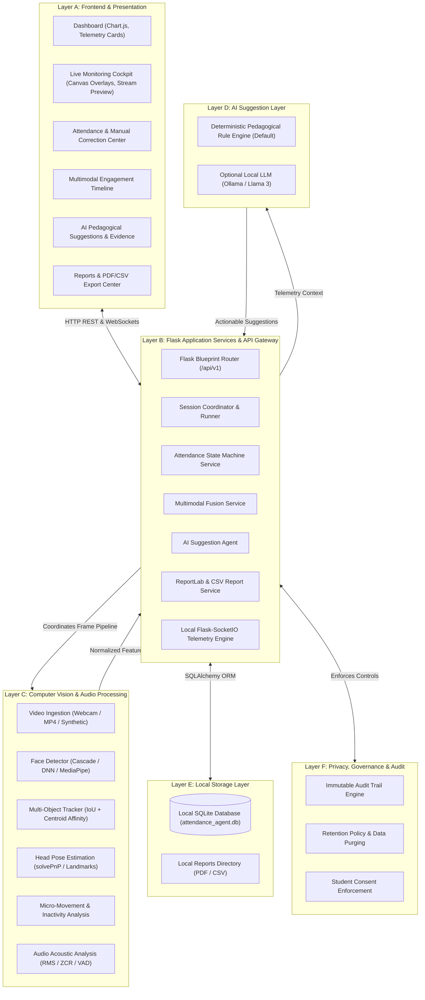

# Multimodal Attendance & Engagement Agent: System Architecture

## Architectural Principles
The **Multimodal Attendance & Engagement Agent** is architected as an **offline-first, privacy-preserving, modular educational telemetry application**. Core operation runs locally with zero mandatory cloud service dependencies or external API transmissions.

## Layered Architecture (Layers A through F)

## Component Breakdown

### Layer A: Presentation
- **Responsive Dashboard**: Live metric tiles for enrolled students, conducted sessions, attendance rates, and active session statuses.
- **Live Cockpit**: Streams video frames and overlays real-time track bounding boxes, head-orientation vectors, active attendee counts, and acoustic energy bars.
- **Chart.js Visualizations**: Interactive line and modality decomposition charts displaying temporal engagement dynamics.

### Layer B: Application Services
- **`SessionRunner`**: Multi-threaded execution engine that regulates video and audio frame ingestion rates, updates trackers, and triggers window fusions every 15 seconds.
- **`AttendanceService`**: In-memory state machine implementing sustained-presence rules:
  $$\text{Attendance status} = \begin{cases} \text{PRESENT}, & \text{accumulated} \ge T_{\text{sustained}} \land \text{coverage} \ge C_{\text{min}} \\ \text{LATE}, & \text{qualified after } T_{\text{late}} \\ \text{UNCONFIRMED}, & \text{otherwise} \end{cases}$$
- **`MultimodalFusionService`**: Dynamic weight renormalization engine combining visual and acoustic signals:
  $$\text{Fused Score} = w_v \cdot S_{\text{visual}} + w_a \cdot S_{\text{audio}}$$
  When one modality is unavailable or silent, the valid modality is automatically scaled to $100\%$ weight without generating false zeros.

### Layer C: Computer Vision & Audio Ingestion
- **Face Detection & Tracking**: Employs bounding box feature extraction, centroid affinity matching, and IoU overlap calculation to maintain stable session-scoped track IDs.
- **Head Pose Estimation**: Uses 3D facial landmarks and camera focal matrix geometry via `cv2.solvePnP` to estimate yaw, pitch, and roll angles.
- **Acoustic Signal Processing**: Evaluates Root Mean Square (RMS) energy and Zero-Crossing Rate (ZCR) on 30ms audio windows to identify human vocal formants and speech segment boundaries.

### Layer D: AI Pedagogical Agent
- **Deterministic Rule Engine (Default)**: Explainable, rule-based inference analyzing trend slopes ($\Delta = \bar{S}_{\text{second\_half}} - \bar{S}_{\text{first\_half}}$), acoustic densities, and head-orientation distributions.
- **Optional Local LLM (Ollama)**: Communicates exclusively with localhost daemon (`http://localhost:11434`) via JSON schema prompts when explicitly toggled.

### Layer E: Local Storage
- Stores structured metadata, session logs, student records, and aggregated 15-second windows in SQLite. Raw video frames and raw audio streams are never committed to disk unless explicitly enabled in Privacy Settings.

### Layer F: Privacy & Governance
- Role-based permissions, password hashing using modern Werkzeug PBKDF2/scrypt, student consent verification, and audit logging for every administrative override.
